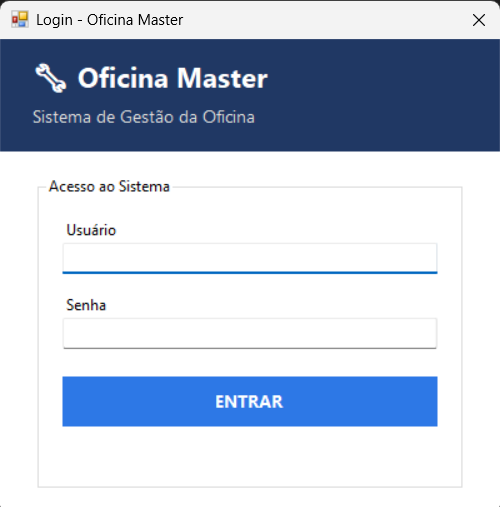
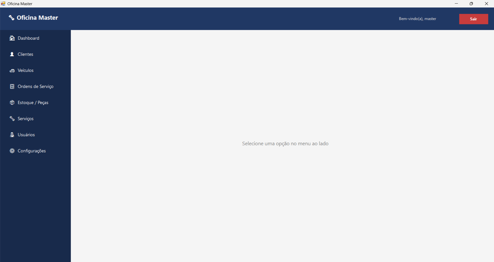
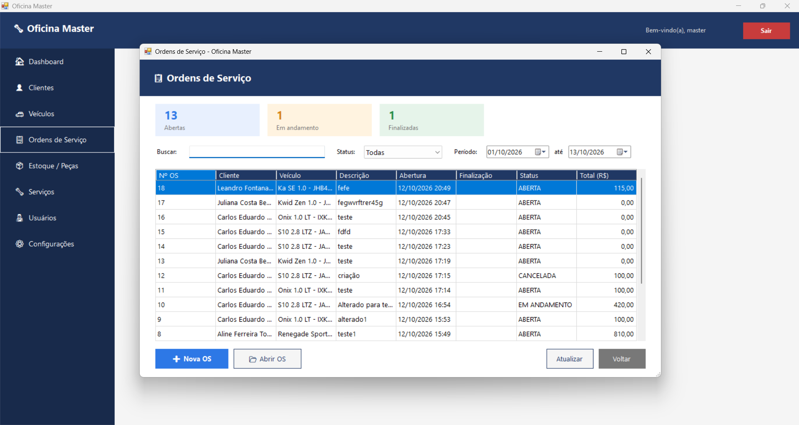
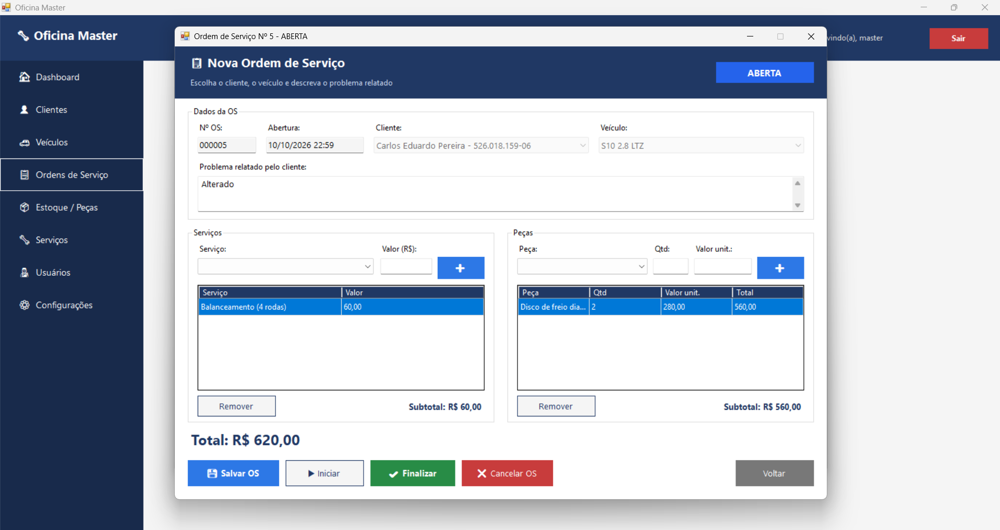
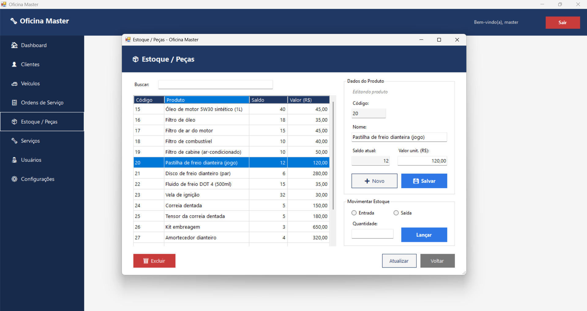

# Oficina Master

Sistema desktop de gestão para oficina mecânica, desenvolvido em **C# com Windows Forms e SQL Server**.
O centro do sistema é a **ordem de serviço**: abrir a OS para o veículo de um cliente, lançar serviços e peças, acompanhar o status e finalizar com baixa automática no estoque.

Criei este projeto para praticar orientação a objetos, organização em camadas e integração com banco de dados com regras de negócio reais.

## Tecnologias

- C# com Windows Forms (.NET Framework 4.7.2)
- SQL Server, com acesso via ADO.NET (`SqlConnection` / `SqlCommand` com consultas parametrizadas e `SqlTransaction`)
- BCrypt.Net-Next para hash de senhas

## Funcionalidades

**Ordens de serviço**
- Abertura de OS vinculada a um cliente e a um dos veículos dele
- Lançamento de **serviços** (com valor sugerido pelo catálogo e editável na OS) e **peças** do estoque (com conferência de saldo)
- Total da OS calculado na hora (serviços + peças)
- Ciclo de status: **Aberta → Em andamento → Finalizada**, ou **Cancelada**, com cores e botões habilitados conforme o status
- **Finalização com baixa no estoque dentro de uma transação**: se alguma peça não tiver saldo suficiente, nada é gravado (rollback)
- Listagem com busca por cliente, veículo ou número da OS, filtro por status e período, coluna de total e cards com a contagem por status

**Cadastros**
- **Clientes** e **veículos** vinculados ao cliente
- **Estoque de peças** com valor de venda, entradas e saídas e destaque para itens com saldo zerado
- **Catálogo de serviços** com valor sugerido e opção de inativar
- **Usuários** com login, senha em hash BCrypt e nível de acesso (Administrador ou Funcionário)

## Regras de negócio

Algumas decisões que tomei no projeto:

- **O valor fica gravado na OS.** Se o preço de um serviço ou peça mudar depois, as ordens antigas continuam com o valor cobrado na época.
- **A baixa no estoque acontece só na finalização**, não ao lançar a peça. Enquanto a OS está aberta, as peças ainda podem ser alteradas.
- **A finalização é protegida contra baixa em dobro.** O status muda antes da baixa, com uma condição que impede finalizar uma OS já finalizada ou cancelada.
- **Cliente e veículo não podem ser trocados** depois que a OS é criada. Só a descrição e os itens podem ser alterados.
- **Não é possível finalizar uma OS sem nenhum serviço ou peça.**
- **OS finalizada ou cancelada fica bloqueada** para edição.
- **Funcionários não alteram o estoque.** Cadastro, movimentação e exclusão de produtos são exclusivos do administrador.

## Estrutura do projeto

O código está separado em camadas, cada uma com uma responsabilidade:

```
ControleEstoqueWindowsForm/
├── Models/       → entidades (OrdemServico, Cliente, Veiculo, Produto, Servico, Usuario...)
├── DAO/          → acesso ao banco de dados (SQL)
├── Services/     → regras de negócio, validações e autenticação
├── Forms/        → telas, organizadas por módulo
├── Validacoes/   → validação e formatação de campos
└── Classes/      → conexão com o banco
```

Fluxo de uma operação: **Form → Service → DAO → banco**. As telas não acessam o banco diretamente.

## Capturas de tela

| Login | Menu principal |
|-------|----------------|
|  |  |

| Ordens de serviço | Ordem de serviço |
|-------------------|------------------|
|  |  |

| Estoque | Serviços |
|---------|----------|
|  |  |

## Como executar

1. Clone o repositório e abra `ControleEstoqueWindowsForm.sln` no Visual Studio.
2. No SQL Server, execute o script [`schema.sql`](schema.sql). Ele cria o banco `OficinaMasterDB`, as tabelas, um usuário administrador e alguns serviços e peças de exemplo.
3. A conexão está em `Classes/Conexao.cs` e usa autenticação do Windows em `localhost`. Ajuste se o seu servidor for diferente.
4. Restaure os pacotes NuGet e execute o projeto.
5. Entre com **login `admin`** e **senha `admin123`**.

## Melhorias futuras

- Impressão da ordem de serviço / relatórios
- Dashboard e tela de configurações (os botões já existem no menu)
- Permissões por perfil também nas ordens de serviço
- Máscaras de entrada para CPF, telefone e placa
- Mover a string de conexão para o `App.config`

## O que aprendi

- Separar o código em camadas e manter as regras de negócio fora das telas
- Usar transações (`BeginTransaction`, `Commit`, `Rollback`) para manter o banco consistente em operações com várias etapas
- Modelar relacionamentos mestre-detalhe (uma OS com vários serviços e peças)
- Fazer consultas com `JOIN` e subconsultas para montar listagens com totais
- Escrever SQL parametrizado para evitar SQL Injection e guardar senhas com hash
- Organizar o histórico do Git com commits pequenos e mensagens padronizadas

## Uso de IA no desenvolvimento

Usei o Claude (IA da Anthropic) como apoio na parte visual do projeto, no layout das telas.

---

Desenvolvido por **João Gabriel Rui de Quadros**, estudante de Análise e Desenvolvimento de Sistemas.